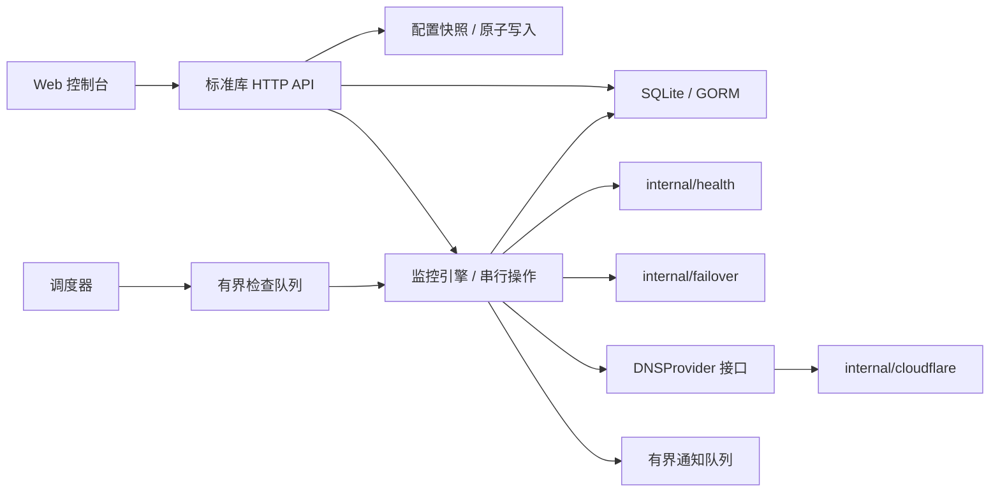

# 架构与扩展边界

## 当前结构

| 模块 | 职责 | 约束 |
| --- | --- | --- |
| `main.go`、`http.go`、`auth.go` | 启动 / 停机、路由、JSON、JWT | 不实现 DNS 决策；限制请求体、请求头和网络超时 |
| `api*.go` | 监控、计划、账号、DNS 和状态接口 | 校验参数和引用，配置变更不能覆盖正在执行的切换 |
| `config.go` | YAML、不可变读快照、原子保存 | 文件写入成功后再替换内存配置；未知账号不回退到其他凭证 |
| `models.go`、`database.go` | 校验、表初始化、状态及事件事务 | 以当前模型建立表结构；配置字段与运行字段分开写入 |
| `monitor.go`、`scheduler.go` | 调度、限流、去重队列、固定 worker、主备探测、DNS 核对、协调提交 | 通过 `HealthChecker` / `DNSProvider` 注入外部行为；停机取消并等待 worker |
| `internal/failover` | 连续计数和目标选择 | 纯计算；不修改已确认的当前地址，不访问数据库或网络 |
| `internal/keylock` | 按策略互斥和可取消等待 | 不同策略不共用锁；最后一个持有者 / 等待者退出时回收条目 |
| `internal/health` | HTTP(S) / Ping 探测 | 源站直连、保留 Host/SNI、总超时、限制响应读取 |
| `internal/cloudflare` | 请求签名、响应校验、分页、退避 | 不依赖数据库、Web 框架或全局配置 |
| `notification.go` | 通知发送 | 2 个工作协程、64 条有界队列，网络调用有截止时间 |
| `static/js` | API、状态、组件和事件 | 共用错误处理和转义；后台页取消轮询，同一轮询不重叠；`LatestRequest` 丢弃过期域名响应 |

HTTP 层采用 `net/http.ServeMux`，GORM 负责当前表结构和事务，SQLite 驱动使用纯 Go 实现。配置统一从 `config/config.yaml` 严格解析，不维护旧路径回退或旧版账号补写逻辑。

## 状态与一致性

三个事实独立保存：

- `current_ip`：最近从 Cloudflare 读取或确认写入的地址。
- `preferred_ip`：恢复后的优先地址。默认主地址；成功的计划或手动切换会更新它。
- `primary_healthy` / `backup_healthy`：最近一次主、备探测结果；尚未检测为 `null`。

`status` 是展示状态：`Unknown`、`Normal`、`Failover`、`Degraded`、`Down`、`Error`。它不再承担“DNS 已经切换”的状态机条件。切换判断依赖实际地址、主备健康和连续计数。

| 条件 | 行为 |
| --- | --- |
| 当前健康且已在优先地址 | 保持；另一端故障显示降级 |
| 当前连续失败达到阈值，另一端健康 | 切换至健康地址 |
| 两端均失败 | 保留记录，显示故障 |
| 当前处于备用路径，优先地址连续恢复 | 切回优先地址 |
| 当前也已达到失败阈值，优先地址本次健康 | 允许提前恢复，避免等待期间继续使用失败源站 |
| Cloudflare 拒绝、超时或确认不匹配 | 不记录成功，保留可重试计数，重新核对远端 |
| 远端地址不属于配置的主备对 | 报错，等待修正配置，避免覆盖未知地址 |

同一策略的自动、手动、计划及编辑 / 删除操作共享锁。锁只为活跃操作及等待者保留；不同策略不会因编号碰撞而阻塞或跳过检查。调度器只替换变化的计划，刷新配置不会重置其他策略的检测周期。

周期调度和启动检查只向队列提交策略 ID；同一 ID 在等待或执行时合并重复触发。固定 worker 排空队列并读取最新配置，空队列释放存储；手动 / 计划切换共用操作并发额度。管理接口先等待对应策略锁，再取得全局配置锁，避免一个慢探测阻塞其他策略的配置操作；锁等待和数据库读取响应请求取消。DNS 编辑仍需在全局配置锁内完成归属检查及写入，避免并发创建监控绕过保护。

Cloudflare 与 SQLite 无法形成跨系统事务。DNS 确认后，状态和成功事件在同一个 SQLite 事务中提交；若本地保存失败，则标记需要重新核对，下一轮读取真实记录。核对发现远端地址变化时，重置属于旧地址的连续计数。停机会拒绝新监控操作，取消并等待自动、手动和计划任务；多次或并发调用 Stop 也会等待同一轮停机完成。

DNS 读取或 TTL 核对失败同样清零连续计数，防止跨过未知状态累计失败 / 恢复。DNS 写入失败仍保留当轮计数供后续重试。切换事件的 `from_unhealthy` 仅在自动切换且本轮确认旧源站不健康时置为 `true`；高频故障统计只聚合这些事件，普通恢复和手动 / 计划操作不进入故障榜。

普通 DNS 编辑器同时按 Record ID 和名称 / 类型检查监控归属；编辑 / 删除先读取真实记录，避免未发现 ID 的策略被绕过。创建或重命名到受管理的名称 / 类型也会被拒绝。

## 有界资源

- 监控 worker 默认 8 个，周期检查进入有界去重队列；每个操作最多并行探测两个源站，重复触发不会堆积。
- 源站探测使用新连接，避免连接池误用其他源站连接或掩盖源站变化；取消无上限的按 IP 缓存客户端。
- HTTP 响应头限制 32 KiB、响应体读取样本限制 32 KiB；请求 identity 编码并关闭自动解压，避免压缩流引入额外解压开销；不下载或验证完整大文件。
- Cloudflare 响应限制 2 MiB，支持分页。429 / 5xx 最多三次尝试；共享退避读取 `Retry-After`（秒数 / HTTP 日期统一最多一小时）并响应取消；创建记录的 POST 不自动重试。
- SQLite 使用 WAL、单连接和 busy timeout；历史按默认 30 天清理，统计在数据库聚合。
- Web 状态刷新使用一次 `/api/status`，不在每轮轮询中请求 Cloudflare Zone 列表。
- 认证、DNS 和通知读取所需的配置值，不复制 YAML 初始化监控列表；只有需要完整配置的调用才深拷贝快照。
- 仪表盘通过 `runtime/metrics` 读取 Go 堆对象占用，避免每次刷新调用 `ReadMemStats` 暂停所有协程。
- 前端请求同时保留超时和调用方取消信号；隐藏页面取消状态请求，切换域名 / 账号取消旧列表请求并清理记录缓存。
- 仪表盘、策略列表和操作后的刷新共用 `statusRequest`，过期轮询无法覆盖新数据；提交按钮在操作期间禁用。
- 监控编辑弹窗复用 `LatestRequest` 管理账号请求，关闭 / 重开即取消旧请求，表单内容和编辑 ID 同步提交；保存与恢复后共用一次状态响应刷新策略列表和仪表盘。
- 通知响应最多读取 16 KiB 并验证完整 JSON；钉钉必须明确返回 `errcode: 0`，Telegram 必须返回 `ok: true`，缺少成功标记、尾随数据和超限响应均报告失败。
- Tailwind 样式在开发时扫描 HTML / JS 生成，运行时使用内置 `utilities.css` 和系统字体；CI 校验生成物同步。

## 可扩展方向

当前版本定位为**单进程、单副本管理一组 DNS 记录**。不能让多个实例同时管理同一条记录；跨实例协调不在当前范围内。

后续如需要，可通过 `HealthChecker` 添加 TCP / 业务内容检测，通过 `DNSProvider` 添加其他 DNS 服务商，通过可选 `DNSConfigurator` 配置服务商支持的 TTL。纯决策模块可扩展为多级备用、最短驻留时间等策略，并继续使用不依赖网络的测试验证。

多副本部署需另行设计租约 / 领导者选举；多点探测需定义仲裁规则；仅替换存储驱动不会自动解决这些一致性问题。
